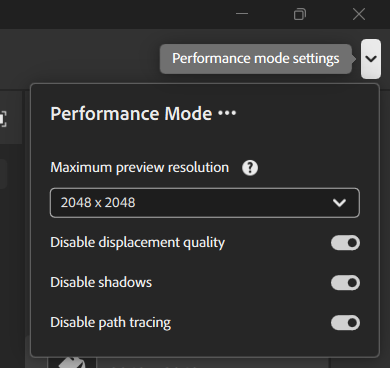

# Mode Performances

Le mode Performances rassemble tous les paramètres susceptibles de ralentir votre workflow : les limites de résolution, les ombres, la qualité du displacement et le traçage de chemin. Éteignez ce dont vous n’avez pas besoin et obtenez la réactivité que vous souhaitez, en particulier sur du matériel plus léger.

>[!NOTE]
>
> Le mode Performances est automatiquement activé avec des limitations maximales si votre matériel ne respecte pas la [configuration minimale requise](../getting-started/system-requirements.md) de Sampler. Cela permet de continuer à utiliser Sampler sur du matériel moins puissant.

## Activer/désactiver le mode Performances

Le mode Performances peut être basculé avec le **bouton Mode Performances** en haut à droite de la **fenêtre Sampler**.

## Modifier les paramètres du mode Performances

Utilisez la liste déroulante en regard du bouton **Mode Performances** pour contrôler les limites activées par le mode Performances.

| Paramètre | Description |
| --- | --- |
| **Résolution maximale de l’aperçu** | Le mode Performances réduit la résolution de l’aperçu pour un rendu plus rapide. Cela ne modifie pas la résolution des actifs importés ou de votre document, mais cela modifie la qualité du moteur de rendu de viewport. |
| **Désactiver la qualité de displacement** | Lorsque ce paramètre est activé, le **mode Performances** verrouille la **valeur de qualité de Displacement** sur 0, désactivant ainsi l&#39;effet de displacement dans le viewport. Pour les matériaux lisses tels que les carreaux ou les tissus fins, cela a un impact visuel minimal, mais peut considérablement améliorer les performances. |
| **Désactiver les ombres** | Les maillages et les matériaux déplacés peuvent convertir des ombres, créant ainsi une image plus réaliste au détriment des performances. Lorsque l&#39;option **Désactiver les ombres** est activée, le mode Performances désactive tout le traitement des ombres, améliorant ainsi les performances. |
| **Désactiver le traçage de chemin** | Le traçage de tracé est une puissante méthode de rendu qui suit les tracés lumineux lorsqu’ils rebondissent sur la scène, créant des rendus photoréalistes. Cependant, le traçage de tracé est coûteux. Lorsque l&#39;option **Désactiver le traçage de chemin** est activée, le mode Performances désactive l&#39;option d&#39;activation du traçage de chemin dans le **Viewport 3D**. |

>[!NOTE]
>
> Le traçage de chemin est accessible à partir de la **barre d&#39;outils de Viewport 3D**.
>
> 
>
> Si le traçage de chemin n&#39;est pas activé, l&#39;activation du mode Performances avec uniquement l&#39;option **Désactiver le traçage de chemin** n&#39;aura aucun effet.
