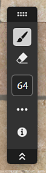

# Tampon clone

<table>
<tr style="border: 0;">
<td width="41.60%" style="border: 0;" valign="top">

Outils **In:**

</td>
<td width="58.30%" style="border: 0;" valign="top">

## Description

L&#39;outil **Tampon de Clone** vous permet de dupliquer ou de corriger manuellement des parties de votre matériau. Il est principalement utilisé pour corriger les seams et supprimer les erreurs des matériaux numérisés, telles que les débris, les ombres ou les artefacts. Vous pouvez mettre en peinture plusieurs tracés de tampon provenant de différentes zones sources dans un seul calque de tampon de Clone, et gérer chaque tampon individuellement dans le **panneau Calques**.

Les images ci-dessous montrent le **tampon de Clone** utilisé pour retirer les débris d&#39;un matériau à neige.

Le matériau de neige comprend un certain nombre de brindilles et d&#39;autres débris éparpillés un peu partout.

Après avoir utilisé l&#39;outil **Tampon de Clone**, les brindilles sont remplacées par de la neige propre.

</td>
</tr>
</table>

## Paramètres

**Paramètres de base**

* **Développer le masque** : 0-1

  Ajustez la distance autour de la zone peinte sur laquelle le filtre tentera de correspondre au matériau sous-jacent.

* **Fusion Atténuation** : 0-1

  Adoucissez le bord de la zone clonée pour le fusionner plus naturellement avec le matériau environnant.

* **Masque de flou** : 0-1

  Ajustez la quantité de détails de contour sur le tampon de duplication. Plus la valeur est élevée, plus les contours sont lisses et ressemblent à des taches.

* **Conserver le rapport** : activer/désactiver

  Lorsque cette option est désactivée, elle vous permet de régler indépendamment les proportions horizontales et verticales de la zone dupliquée.

  * **Horizontal** : 0-2
  * **Vertical** : 0-2
* **Rotation** : -180 à 180

  Faites pivoter la zone tamponnée pour la faire correspondre à la direction ou au grain du matériau environnant.

* **Symétrie horizontale** : basculer

  Permet de refléter la zone tamponnée le long d’un axe horizontal.

* **Symétrie verticale** : basculer

  Permet de refléter la zone tamponnée le long d’un axe vertical.

**Fusion Atténuation**

Utilisez les commandes de fusion Atténuation par couche pour régler indépendamment la force de fusion de chaque couche matériau.

**Avancé**

* **Intensité normale** : 0-2

  Réglez la force de la map normal dans la zone estampée pour contrôler la façon dont la surface clonée répond à l’éclairage.

* **Position source** :
  * Horizontal : 0-1 : permet de régler la position horizontale de la source de duplication.
  * Vertical : 0-1 : permet de régler la position verticale de la source de duplication.
* **Position cible** :
  * Horizontal : 0-1 : permet de régler la position horizontale de la cible de la peinture.
  * Vertical : 0-1 : permet de régler la position verticale de la cible de la peinture.
* **Mode Répétition** : liste déroulante

  Activer ou désactiver la répétition lors du clonage à proximité des bordures du matériau.

## Utilisation du tampon de Clone

1. Cliquez sur **Tampon de Clone** dans la barre latérale gauche ou ajoutez-le à partir du bouton **Ajouter un calque** dans le panneau **Calques**. Un nouveau calque Tampon de Clone apparaît en haut de la pile de calques et la **Vue 2D** s&#39;ouvre automatiquement.

1. **Définir un point source** : maintenez `Ctrl` (`Cmd` sur macOS) enfoncé et cliquez sur une zone propre du matériau dans la **Vue 2D**. Cela définit la zone géographique qui sera copiée.

   > 📸 CAPTURE D&#39;ÉCRAN [ID : clone-stamp-001]
   > Afficher : viewport 2D avec un réticule du point source visible sur une zone propre d’un matériau à neige
   > État : Calque de tampon de Clone sélectionné ; Ctrl maintenu enfoncé ; indicateur source visible
   > Annotation : libeller le réticule source

1. **Peinture sur la zone problématique** : cliquez et faites glisser sur la zone que vous souhaitez corriger. Le matériau du point source remplace la zone peinte en temps réel.

   {width="300px"}

1. Ajustez la **fusion Atténuation** et le **masque développé** dans le **panneau Propriétés** pour affiner la façon dont la zone clonée se fond avec son environnement.

>[!NOTE]
>
> Évitez de placer le point source près de la zone que vous dupliquez. Si la source chevauche la zone problématique, l’artefact peut être cloné avec le contenu nettoyé.

## Utilisation de plusieurs sources

Vous pouvez ajouter plusieurs points source dans un même calque de tampon de Clone, chacun ayant ses propres paramètres de position, de rotation et de fusion. Cela vous permet de corriger plusieurs zones différentes ou de dessiner à partir de plusieurs zones propres différentes sans empiler plusieurs calques.

Pour ajouter une nouvelle source, maintenez `Ctrl` (`Cmd` sur macOS) enfoncé et cliquez sur une nouvelle zone dans la **Vue 2D**. Une nouvelle entrée de tampon apparaît sous le calque Tampon de Clone dans le **panneau Calques**.

> 📸 CAPTURE D&#39;ÉCRAN [ID : clone-stamp-002]
> Afficher : le panneau Calques avec un calque Tampon de Clone développé, affichant trois entrées de tampon individuelles imbriquées en dessous
> État : calque Tampon de Clone développé ; trois tampons visibles avec différentes positions source
> Annotation : flèche pointant vers les entrées de tampon imbriquées dans le panneau Calques

Sélectionnez n&#39;importe quelle entrée de tampon dans le **panneau Calques** pour ajuster ses paramètres indépendamment dans le **panneau Propriétés**, y compris sa position source, sa rotation et ses paramètres de fusion.

>[!TIP]
>
> Utilisez l&#39;**aperçu du pinceau** dans la **Vue 2D** pour voir le résultat du tampon avant de valider un tracé. Cela vous permet de vérifier que la zone source correspond à la zone environnante avant de peindre.

## Barre d’outils

<table>
<tr style="border: 0;">
<td width="16.67%" style="border: 0;" valign="top">

</td>
<td width="83.33%" style="border: 0;" valign="top">

Lorsqu&#39;un calque Tampon de Clone est sélectionné, une barre d&#39;outils apparaît dans la **Vue 2D**.

* Sélectionnez l&#39;**outil Pinceau** pour l&#39;ajouter au masque.
* Sélectionnez l&#39;**outil Effacer** pour le supprimer du masque.
* Définissez la taille de l’outil actuellement sélectionné.
* Accéder à des commandes supplémentaires :
  * **répétition du pinceau** : activez les répétitions X et Y.
  * **Incrustation** : basculez la visibilité de l&#39;incrustation tout en passant le curseur de la souris sur la Vue 2D.
* Afficher **les contrôles Vue 2D**.

</td>
</tr>
</table>

>[!NOTE]
>
> Comme pour les autres barres d’outils de viewport, vous pouvez faire glisser la poignée en haut de la barre d’outils pour la repositionner, double-cliquer dessus pour basculer entre une disposition verticale et horizontale ou utiliser le double chevron pour la masquer ou la développer.

## Raccourcis

| Action | Windows + Linux | macOS |
| --- | --- | --- |
| Augmenter l’épaisseur du pinceau | `]` ou `Ctrl` + Molette de la souris | `]` ou `Cmd` + Molette de la souris |
| Diminuer l’épaisseur du pinceau | `[` ou `Ctrl` + Molette de la souris | `[` ou `Cmd` + Molette de la souris |
| Définir la source | `Ctrl` + clic gauche | `Cmd` + clic gauche |

## Associé

* [Chaîne](./warp.md)
* [Création d’une mosaïque](./make-it-tile.md)
* [De l’image au matériau](./image-to-material.md)
